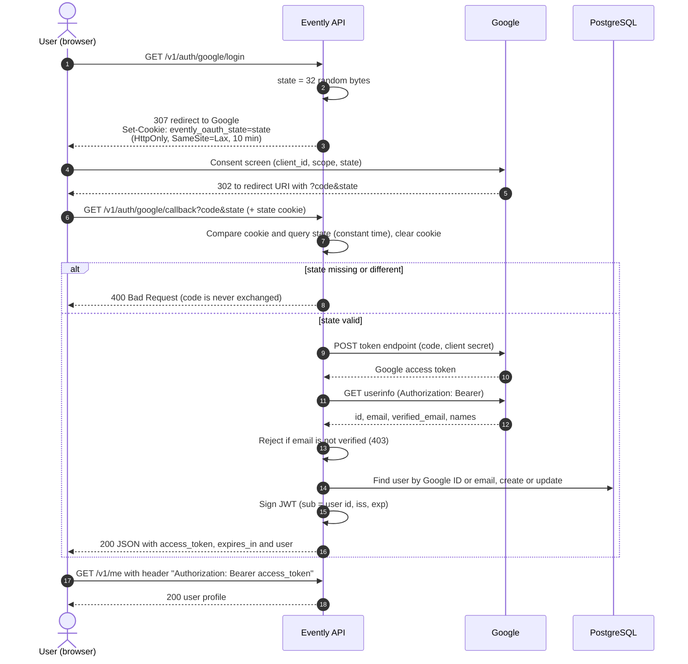

# Evently API

[](https://github.com/guvanch999/evently-app/actions/workflows/ci.yml)

[](LICENSE)

A small REST backend for an events app, written in Go. Users sign in with
**Google OAuth2**, receive the service's own **JWT access token**, and use it to
manage **events** (create, list, read, update, delete) stored in **PostgreSQL**.

It is a compact, readable example of a production-style Go service: Echo
HTTP server, GORM repositories, layered handlers/services, a central error
handler, config from environment variables, and a test suite that runs without
a database or network access.

## Features

- **Sign in with Google** (authorization code flow) with a random `state`
  value stored in a short-lived `HttpOnly` cookie for CSRF protection.
- Only Google accounts with a **verified email** are accepted; users are
  created on first sign-in and linked by Google ID (or by email for existing
  accounts).
- **Own JWT access tokens** (HS256) with issuer, expiry and algorithm checks;
  Google tokens never leave the server.
- **Profile** endpoints: `GET /v1/me` and `PATCH /v1/me` (name, Instagram
  nickname, birth date).
- **Events CRUD** with pagination; anyone can read, only the owner can edit or
  delete.
- Consistent JSON errors (`{"code", "message", "details"}`), request IDs,
  rate limiting, CORS, security headers, graceful shutdown.
- Secrets are never logged: the config type redacts them whenever it is formatted.
- Dockerfile (multi-stage, distroless, non-root), Docker Compose with
  PostgreSQL, GitHub Actions CI.

## Tech stack

Go · [Echo v4](https://echo.labstack.com/) · [GORM](https://gorm.io/) +
PostgreSQL · [golang.org/x/oauth2](https://pkg.go.dev/golang.org/x/oauth2) ·
[golang-jwt/jwt v5](https://github.com/golang-jwt/jwt) ·
[go-playground/validator](https://github.com/go-playground/validator) ·
[caarlos0/env](https://github.com/caarlos0/env) · Swagger via
[swaggo](https://github.com/swaggo/swag)

## Authentication flow



The callback responds with JSON, which suits API clients and testing. A browser
front end would normally put its own page behind the redirect URI, or the
callback would be changed to redirect to the front end.

## API

Base path: `/v1`. Protected routes need `Authorization: Bearer <access_token>`.

| Method | Path | Auth | Description |
| --- | --- | --- | --- |
| GET | `/health` (no `/v1` prefix) | – | Liveness check |
| GET | `/v1/auth/google/login` | – | Sets the state cookie and redirects to Google |
| GET | `/v1/auth/google/callback` | – | Verifies state, signs the user in, returns an access token |
| GET | `/v1/me` | JWT | Current user's profile |
| PATCH | `/v1/me` | JWT | Update `first_name`, `last_name`, `instagram_nickname`, `birth_date` (`YYYY-MM-DD`, empty string clears it) |
| GET | `/v1/events?page=1&limit=20` | – | Events ordered by start time (`limit` ≤ 100) |
| GET | `/v1/events/{id}` | – | One event |
| POST | `/v1/events` | JWT | Create an event owned by the caller |
| PATCH | `/v1/events/{id}` | JWT, owner | Partial update |
| DELETE | `/v1/events/{id}` | JWT, owner | Delete (204) |

Swagger UI is served at `/swagger/index.html`.

### Examples

```bash
TOKEN=...   # access_token from the callback response

curl -X POST http://localhost:8080/v1/events \
  -H "Authorization: Bearer $TOKEN" -H "Content-Type: application/json" \
  -d '{"title":"Go meetup","location":"Online","starts_at":"2026-12-01T18:00:00Z","ends_at":"2026-12-01T20:00:00Z"}'
```

```json
{
  "data": {
    "id": "6f1c…",
    "owner_id": "a2b9…",
    "title": "Go meetup",
    "description": "",
    "location": "Online",
    "starts_at": "2026-12-01T18:00:00Z",
    "ends_at": "2026-12-01T20:00:00Z",
    "created_at": "…",
    "updated_at": "…"
  }
}
```

```bash
curl "http://localhost:8080/v1/events?page=1&limit=10"
# {"data":{"list":[...],"pagination":{"page":1,"limit":10,"total":1}}}
```

Errors share one shape:

```json
{ "code": 403, "message": "Forbidden", "details": "only the event owner can modify this event" }
```

## Configuration

Settings are read from environment variables; a `.env` file in the working
directory is loaded if present (see [`.env.example`](.env.example)). The service
refuses to start if a required value is missing.

| Variable | Required | Default | Description |
| --- | --- | --- | --- |
| `GO_ENV` | no | `development` | `development` serves Swagger over `http://localhost:PORT` |
| `PORT` | no | `8080` | HTTP port |
| `APP_URL` | no | `http://localhost:8080` | Public URL (used for the Swagger host outside development) |
| `CORS_ALLOW_ORIGINS` | no | `http://localhost:3000` | Comma-separated allowed origins |
| `POSTGRES_URI` | **yes** | – | PostgreSQL DSN |
| `DISABLE_AUTO_MIGRATION` | no | `true` | Set `false` to run GORM AutoMigrate on startup |
| `JWT_SECRET` | **yes** | – | HMAC key for access tokens, at least 32 characters |
| `JWT_ISSUER` | no | `evently-app` | `iss` claim, checked on every request |
| `JWT_ACCESS_TTL` | no | `1h` | Access token lifetime (Go duration) |
| `GAUTH_CLIENT_ID` | **yes** | – | Google OAuth client ID |
| `GAUTH_CLIENT_SECRET` | **yes** | – | Google OAuth client secret |
| `GAUTH_CLIENT_REDIRECT_URI` | **yes** | – | Must match the Google console, e.g. `http://localhost:8080/v1/auth/google/callback` |
| `GAUTH_USER_INFO_URL` | no | `https://www.googleapis.com/oauth2/v2/userinfo` | Google userinfo endpoint |

The state cookie gets the `Secure` flag automatically when the redirect URI
uses `https://`.

## Getting Google OAuth credentials

1. Open the [Google Cloud Console](https://console.cloud.google.com/) and create
   (or select) a project.
2. Go to **APIs & Services → OAuth consent screen**, choose *External*, fill in
   the app name and support email, and add the scopes `openid`, `.../auth/userinfo.email`
   and `.../auth/userinfo.profile`. While the app is in *Testing* mode, add your
   Google account under **Test users**.
3. Go to **APIs & Services → Credentials → Create credentials → OAuth client ID**,
   choose **Web application**, and add
   `http://localhost:8080/v1/auth/google/callback` to **Authorized redirect URIs**.
4. Copy the client ID and client secret into `.env` as `GAUTH_CLIENT_ID` and
   `GAUTH_CLIENT_SECRET`.

## Running locally

Requirements: Go 1.23+ and PostgreSQL 13+ (or Docker).

```bash
cp .env.example .env          # then fill in the Google credentials and JWT_SECRET
docker compose up -d db       # or point POSTGRES_URI at your own PostgreSQL
go run .
```

Open <http://localhost:8080/v1/auth/google/login> in a browser, sign in, and
copy `access_token` from the JSON response.

## Running with Docker

```bash
cp .env.example .env          # fill in GAUTH_CLIENT_ID, GAUTH_CLIENT_SECRET, JWT_SECRET
docker compose up --build
```

Compose starts PostgreSQL 16 and the API on port 8080, waits for the database
health check, and enables AutoMigrate. The runtime image is a static binary on
`distroless/static` running as a non-root user.

## Tests

```bash
go test ./...
```

The suite needs no database, Docker or internet access:

- **End-to-end HTTP tests** (`internal/router_test.go`) mount the real routes on
  Echo and replace Google with an `httptest` server for the token and userinfo
  endpoints. They cover the login redirect, the callback, rejection of missing
  or forged `state` (without exchanging the code), unverified emails, linking an
  existing account by email, `/me`, and the events API including owner-only edits.
- **Unit tests** for JWT issuing/verification (expired, tampered, wrong key or
  issuer, `alg=none`), the auth middleware, the state cookie, the events
  service (validation, ownership, pagination), and config redaction.
- Repositories are replaced with in-memory fakes from `internal/testutil`.

CI (`.github/workflows/ci.yml`) checks formatting and runs `go build`, `go vet`,
`go test -race`, and a Docker image build.

## Project structure

```
.
├── main.go                     # entry point: Swagger, middlewares, routes, graceful shutdown
├── cmd/server.go               # builds Echo, config, DB connection, validator, error handler
├── docs/                       # Swagger spec (generated by swag)
├── internal/
│   ├── config/                 # env config, validation, secret redaction
│   ├── database/               # GORM/PostgreSQL connection and AutoMigrate
│   ├── models/                 # User, Event
│   ├── dto/                    # request/response types and mapping
│   ├── repositories/           # GORM data access
│   ├── services/               # auth (Google + JWT), users, events
│   ├── handlers/               # HTTP handlers, OAuth state cookie
│   ├── middleware/             # global middlewares, JWT auth middleware
│   ├── testutil/               # in-memory repository fakes for tests
│   └── router.go               # wiring and route table
└── utils/                      # error handler, error types, validator, helpers
```

## Regenerating the Swagger spec

Handlers carry swag annotations. The committed spec in `docs/` currently only
contains the API metadata; regenerate it to include every endpoint:

```bash
go run github.com/swaggo/swag/cmd/swag@v1.16.4 init --parseInternal
```

## Limitations and next steps

- Only access tokens are issued; there is no refresh token or server-side
  revocation, so clients sign in again when the token expires.
- The schema is managed with GORM AutoMigrate rather than versioned migrations.
- The rate limiter is in memory, so limits apply per instance.
- No front end is included; the OAuth callback returns JSON.

## License

[MIT](LICENSE) © Guvanch D.
